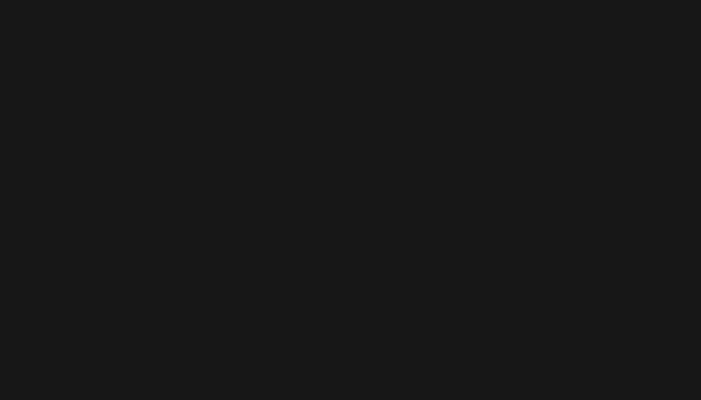

# Go Go Go!

Go Go Go! is a terminal race demonstrating a strength of Go, concurrency strategies. Each lane does the same work and the track animates from progress while finish order comes from measured elapsed time.



## Run

Requires Go 1.22 or later. In a terminal:

```sh
go run ./cmd/gogogo
go run ./cmd/gogogo -race counter
go run ./cmd/gogogo -race all
go run ./cmd/gogogo -race all -workers 2,4,16,64 -procs 8
```

`-race` accepts `sum`, `counter`, or `all`. A single race defaults to one timed trial; `all` runs both races and defaults to five trials per race. `-workers` accepts a comma-separated list of positive worker counts (default `2,4,16,64`); duplicates are ignored. Sum Sprint runs a sequential baseline and one lane per listed worker count, while Counter Clash runs each strategy with the largest listed count.

`-max` sets the per-lane deadline (default `5s`), `-seed` fixes Sum Sprint's generated input (default `1`), and `-procs` pins and displays `GOMAXPROCS` (default: the current Go runtime setting). `-fps` sets the interactive refresh rate from 1 to 60 (default `30`). Use `-no-color` or set `NO_COLOR` to disable lane colors.

In an interactive terminal with keyboard input, use the up/down arrows to select a lane; `q` or Ctrl+C quits. The terminal alternate screen, cursor, and input mode are restored on exit. After the race, a final-lap replay stretches the median finish times into an 8-to-30-second replay, paced at about 20 times the longest non-DNF median time. The checkered-flag results stay on screen until a key is pressed; if keyboard input is unavailable, they close automatically after three seconds. Non-interactive output skips the animation and prints the final results.

## Races

- **The Sum Sprint:** sums 50 million deterministic integers sequentially and with the requested worker counts.
- **The Counter Clash:** performs 10 million increments using a mutex, `sync/atomic`, a channel-owned counter, and sharded atomic counters followed by a merge. Each strategy uses the largest requested worker count.

Each race gives its lanes the same work, uses a shared start barrier and a reduced-size untimed warmup, and emits progress events that may be dropped when the renderer is behind. Finish events are delivered reliably, and per-lane timing stops before a finish event is published. Trial summaries rank non-DNF lanes first, then order each group by median measured duration. A lane is marked DNF for a timed trial if it returns an error, including a timeout at `-max`; it is marked DNF in the summary if this occurs in at least half of its timed trials. Progress is deliberately not used to rank finishers.

The renderer is the only screen writer. The broker fans events out to the renderer and commentator; progress is best-effort, while finish and lifecycle events are delivered reliably. In interactive mode, the timed run starts alongside the five-light countdown; live car movement is hidden, then the final-lap replay shows the cars with GO GO GO flashing every 500 ms until the first replay car reaches 50%. The animation does not delay benchmark execution. The interactive track requires a terminal at least 72x15; smaller terminals show a resize prompt.

## Development

```sh
go test ./...
go test -race ./...
go vet ./...
```

The only direct external dependency is `golang.org/x/term` for terminal size and mode handling; the UI itself uses no TUI framework.